<div align="center">


# DataSense

### AI-Powered Multi-Agent Data Analytics Platform

Transform raw datasets into actionable insights using natural-language analytics, secure SQL execution, and intelligent multi-agent orchestration.


</div>

---

## Table of Contents

- [Hero Preview](#hero-preview)
- [Overview](#overview)
- [Key Features](#key-features)
- [Screenshots Gallery](#screenshots-gallery)
- [Technology Stack](#technology-stack)
- [Architecture Overview](#architecture-overview)
- [Installation and Local Development](#installation-and-local-development)
- [Docker Deployment](#docker-deployment)
- [AI Configuration & Data Privacy](#ai-configuration--data-privacy)
- [Security Architecture](#security-architecture)
- [Project Structure](#project-structure)
- [Testing & Verification](#testing--verification)
- [Roadmap](#roadmap)
- [Documentation](#documentation)
- [Contributing & License](#contributing--license)

---

## Hero Preview

<p align="center">
  <a href="docs/assets/screenshots/dashboard-overview.png">
    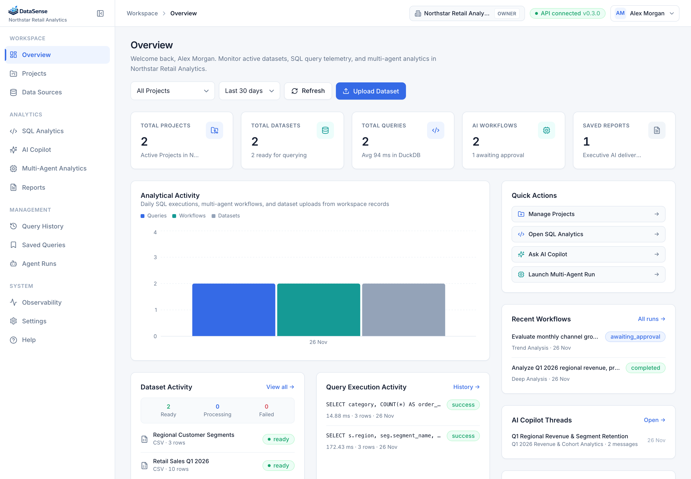
  </a>
</p>

---

## Overview

**DataSense** is an enterprise SaaS analytics workspace designed for analysts, engineers, and business teams who want to move seamlessly from raw tabular files to verified SQL insights and executive reports without exporting sensitive rows to third-party AI APIs.

It unifies:
- **Structured Dataset Ingestion & Profiling**: Upload CSV, multi-sheet Excel (`.xlsx`), JSON, and Parquet files into normalized Parquet storage with schema inference, data quality checks, PII tagging, and version history.
- **Deterministic DuckDB SQL Studio**: Query multiple datasets in-process via SQLGlot-validated DuckDB views with zero-copy PyArrow access, query history, saved query libraries, and interactive charts.
- **Schema-Only AI Analytics Copilot**: Ask natural-language questions powered by Google Gemini (`langchain-google-genai`), receiving SQLGlot-verified SQL drafts, plain-English explanations, and follow-up prompts without sending raw customer rows by default.
- **Stateful LangGraph Multi-Agent Orchestration**: Run 7 analytical modes coordinated across 8 specialized agents with durable checkpoint persistence (`PostgresSaver` / `SqliteSaver`), mandatory SHA-256 human-in-the-loop SQL approval gates, deterministic Polars statistical analysis, and 11-section executive BI reports.

---

## Key Features

### Authentication and Workspace Governance
- **Modern Split-Screen Sign-In & Registration**: In-memory Zustand JWT access tokens paired with rotating SHA-256 hashed HttpOnly `datasense_refresh_token` cookies and reuse family revocation.
- **Multi-Tenant Organizations & Projects**: Strict tenant-isolated project workspaces returning `404` on cross-tenant resource lookups.
- **Role-Based Access Control (RBAC)**: Granular enforcement across `OWNER`, `ADMIN`, `ANALYST`, and read-only `VIEWER` roles.

### Dataset Ingestion & Profiling
- **Multi-Format Upload**: `.csv`, `.xlsx` (including multi-sheet discovery), `.json`, and `.parquet` validated via extension checks, magic bytes, file ceilings (`25 MB`), and XLSX zip-bomb limits.
- **Automated Normalization & Conversion**: Column identifier sanitization (`snake_case`) and Snappy-compressed Parquet generation via Polars and PyArrow.
- **Profiling & Sensitivity Classification**: Computes column nulls, distinct counts, numeric stats, quality alerts, and heuristic PII classification (`email`, etc.).
- **Dataset Versioning**: Immutable versioned snapshots (`v1`, `v2`, ...) with isolated storage paths and preview pagination.

### SQL Analytics Studio
- **Sandboxed DuckDB Engine**: In-memory execution over authorized Parquet views with `enable_external_access = false`, `lock_configuration = true`, memory limits, thread bounds, and timeout enforcement.
- **Mandatory SQLGlot AST Gate**: Blocks DDL/DML, multiple statements, system catalogs, and filesystem scanning functions (`read_csv`, `read_parquet`, `glob`).
- **Interactive IDE**: CodeMirror 6 SQL editor with formatting, live catalog sidebar, query history audit logs, saved queries CRUD, CSV export, and chart previews.

### AI Analytics Copilot
- **Three-Panel Conversational Workspace**: Searchable conversation sidebar, document-structured assistant responses with SQL draft cards, and collapsible Dataset Scope schema tree.
- **Automated AST Repair & Explanations**: Validates generated SQL against project schemas, runs a controlled repair attempt on syntax/table errors, and generates plain-English SQL explanations.
- **One-Click Execution**: Validate and run Copilot SQL drafts directly inside DuckDB or open them inside SQL Studio.

### Multi-Agent Analytics (LangGraph)
Orchestrates conditional and parallel workflows across 8 domain agents (`Supervisor`, `Data Discovery`, `Data Quality`, `SQL Analyst`, `Statistical Analyst`, `Visualization`, `Insight`, and `Report Generation`):
- **7 Workflow Modes**: Quick Analysis, Deep Analysis, Data Quality Audit, Trend Analysis, Comparative Analysis, Anomaly Investigation, and Report Generation.
- **Human-in-the-Loop Approval Gate**: Execution pauses via LangGraph `interrupt()` prior to running proposed queries; approval requires a matching SHA-256 `approval_hash` bound cleanly to the exact SQL plan and active `dataset_version_snapshot`.
- **Deterministic Statistics & Anomalies**: Computes distributions, IQR/Z-score outliers, and rankings via Polars (`StatisticalService`) directly from bounded DuckDB artifacts.

### Reporting, Visualization & Operations
- **11-Section BI Reports**: Compiles Executive Summary, Scope, Objectives, Key Findings, Statistical Analysis, Data Quality, Trends, Visualization Recommendations, Business Recommendations, Limitations, and Query Evidence References with Markdown export and print stylesheets.
- **Production Observability**: `/api/v1/health/live`, `/api/v1/health/ready`, Prometheus `/api/v1/metrics`, structured redacting JSON logs, correlation IDs, and an Owner/Admin Operational Dashboard (`/admin/observability`).

---

## Screenshots Gallery

All screens below are real captures from the running application populated with synthetic demo data (`Northstar Retail Analytics`). See [Screenshots Index](docs/screenshots.md) for detailed descriptions.

### Workspaces, Data & SQL Studio

| Projects Workspace | Data Sources |
| :---: | :---: |
| 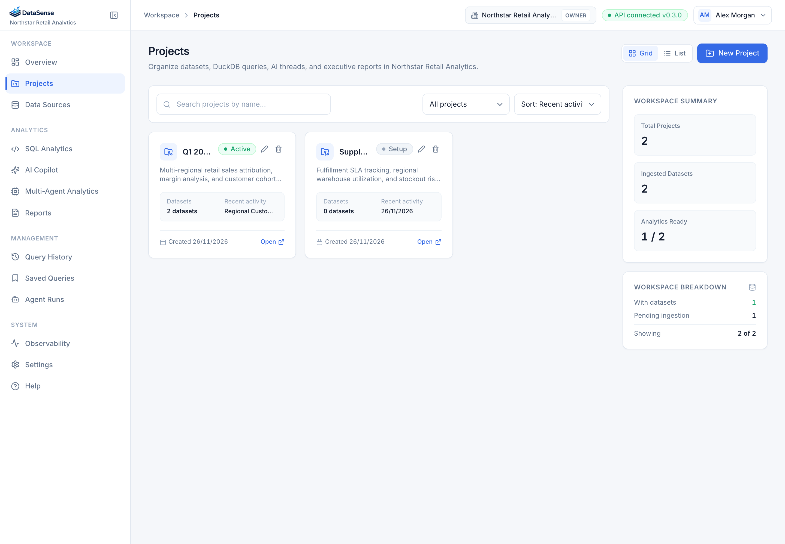 | 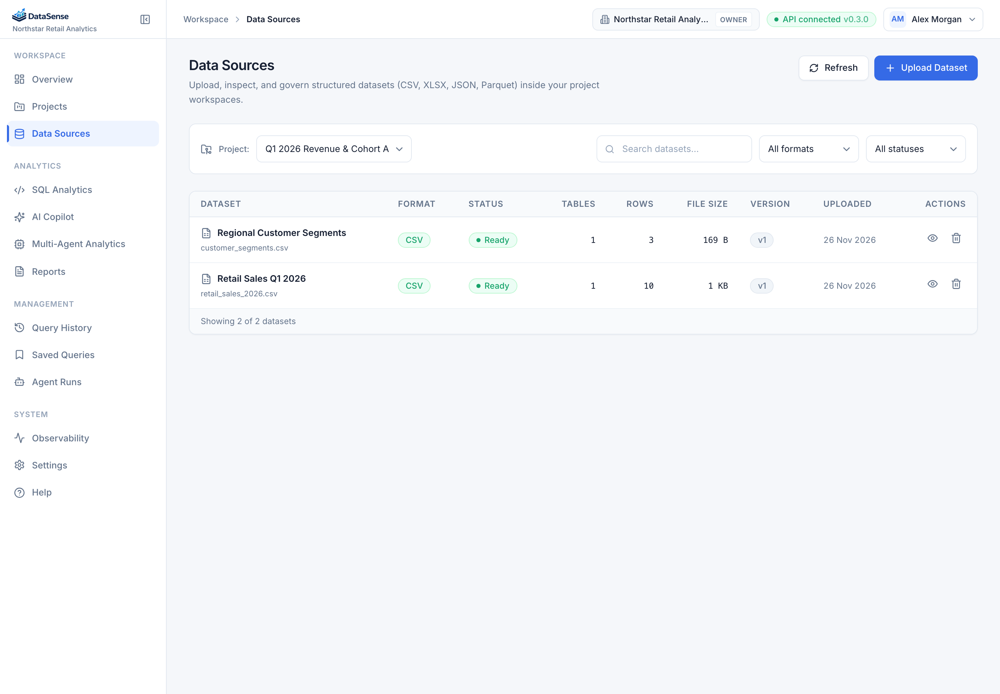 |

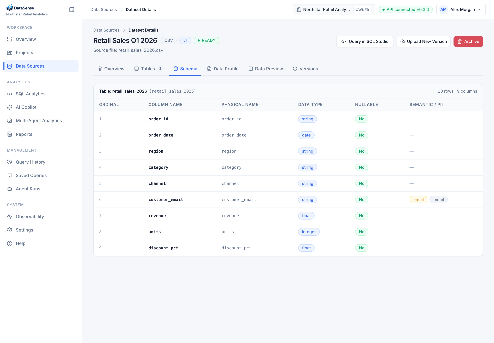

| SQL Analytics Editor & Catalog | DuckDB Query Execution Results |
| :---: | :---: |
| 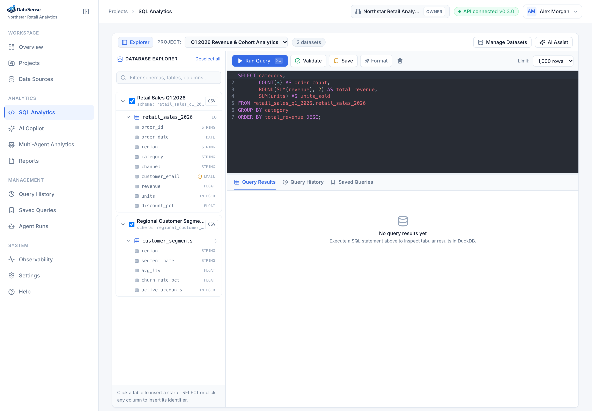 | 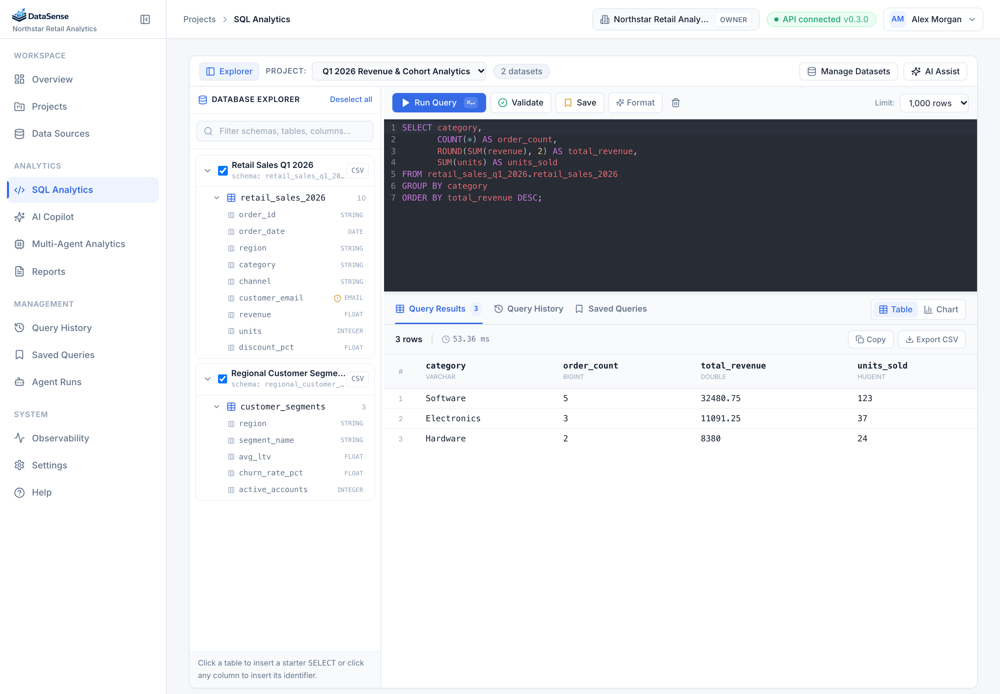 |

### AI Copilot, Multi-Agent Workflows & Approvals

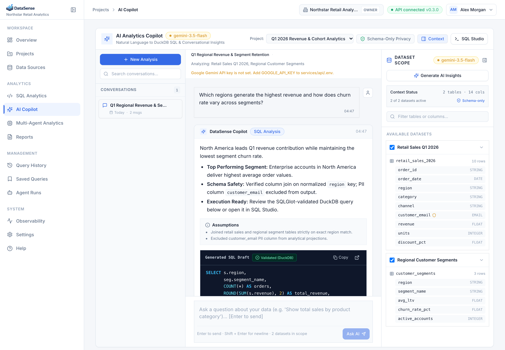

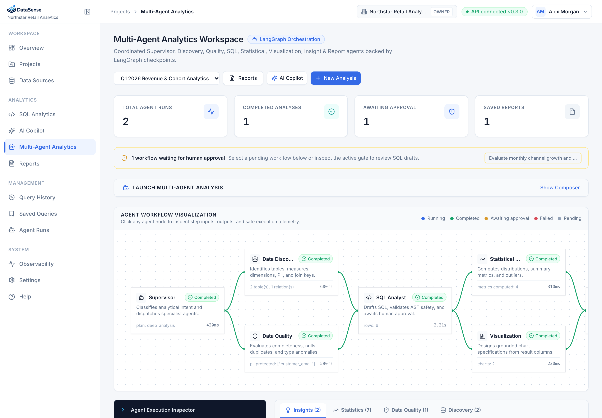

| Agent Execution Timeline & Visualization Gallery | Human-in-the-Loop SQL Approval Gate |
| :---: | :---: |
| 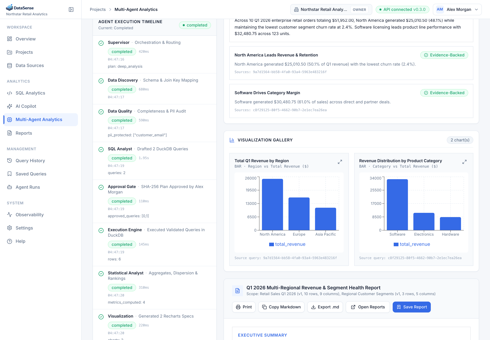 | 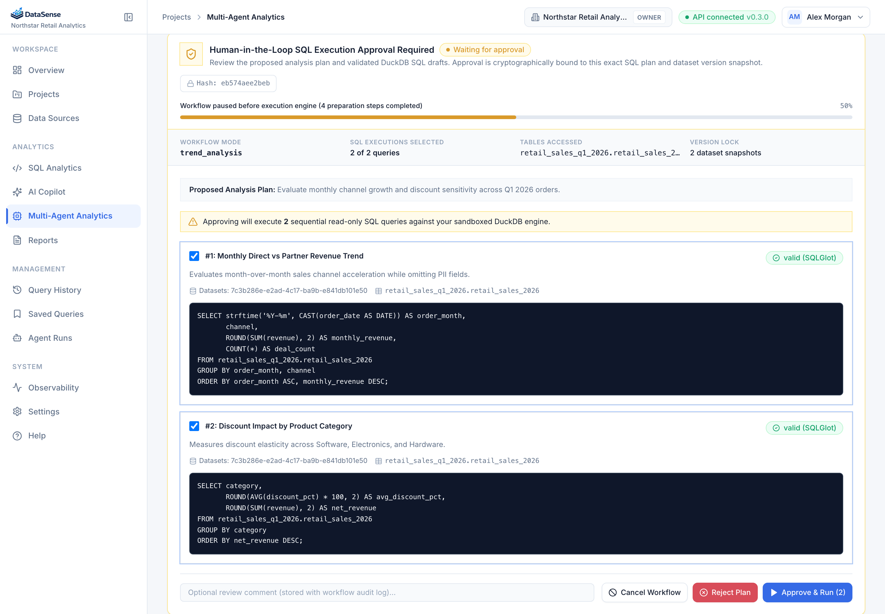 |

### Executive Reports, Authentication & Responsive Views

| 11-Section Executive Analytical Report | Settings & Profile |
| :---: | :---: |
| 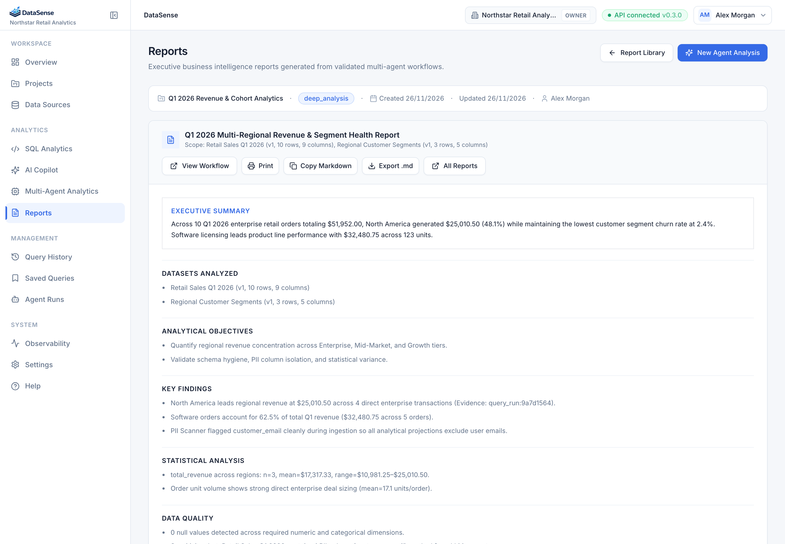 | 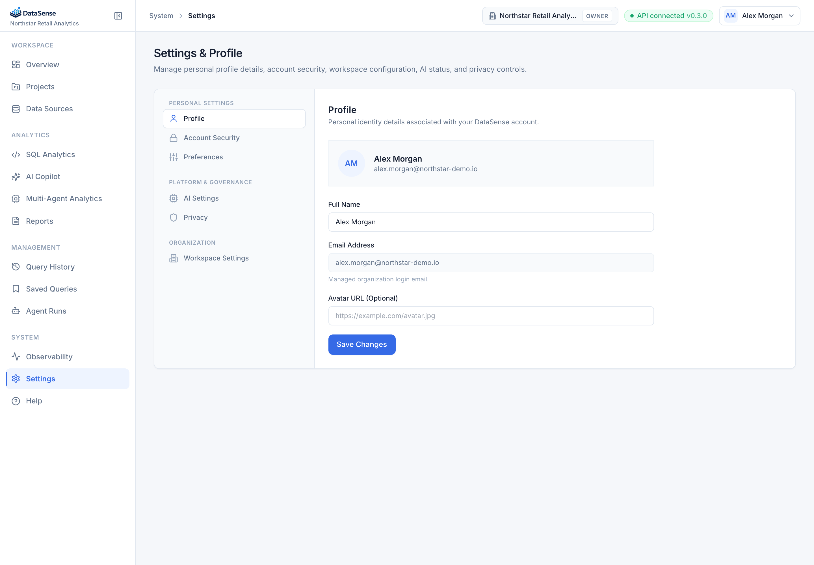 |

| Split-Screen Enterprise Login | Responsive Mobile (`390×844`) |
| :---: | :---: |
| 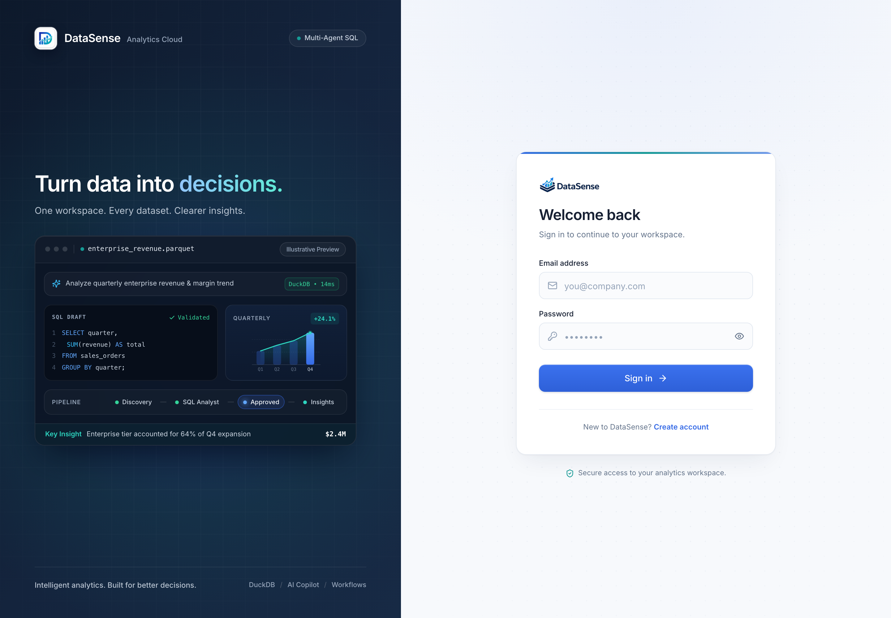 | 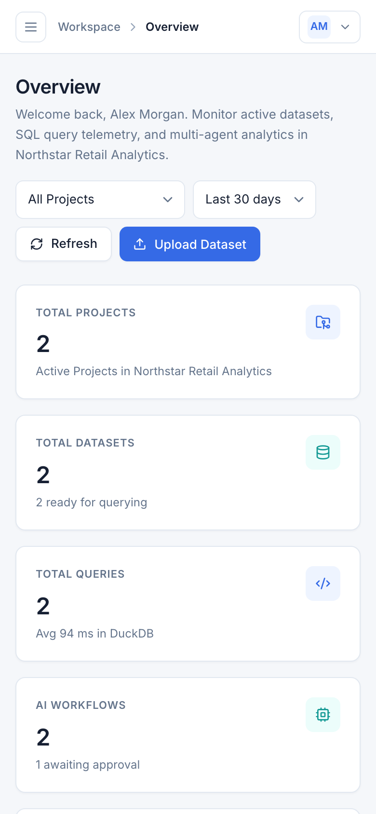 |

---

## Technology Stack

| Layer | Technologies | Responsibility |
|---|---|---|
| **Backend API** | Python 3.11+, FastAPI, Uvicorn, Pydantic v2 (`pydantic-settings`) | Typed REST endpoints, request lifecycle, fail-closed settings, RBAC & DB rate limiting |
| **Persistence & Migrations** | PostgreSQL 14+, SQLAlchemy 2.0, Alembic (`0001`–`0006`), `psycopg` 3, SQLite (dev) | Multi-tenant relational metadata, query audit trails, AI threads, reports & checkpoints |
| **Security & Auth** | `pwdlib[argon2]`, `PyJWT`, SQLGlot | Password hashing, rotating refresh sessions, AST-based SQL injection prevention |
| **Data & Analytical Engine** | Polars, PyArrow, `fastexcel`, DuckDB | Multi-format ingestion, profiling, PII scan, Snappy Parquet conversion & SQL queries |
| **AI & Multi-Agent** | Google Gemini API, LangChain (`langchain-google-genai`), LangGraph | Schema-only NL-to-SQL generation, multi-agent `StateGraph`, durable interrupts & insights |
| **Frontend SPA** | React 18, TypeScript, Vite, Tailwind CSS, React Router v6, TanStack Query, Zustand | Modular lazy-loaded enterprise SPA, CodeMirror 6 SQL Studio, Recharts visualizations |
| **Infrastructure & CI** | Docker, Docker Compose, Nginx 1.27, GitHub Actions, Prometheus format | Containerized API/Nginx runtime, reverse proxy security headers, PostgreSQL CI checks |

---

## Architecture Overview

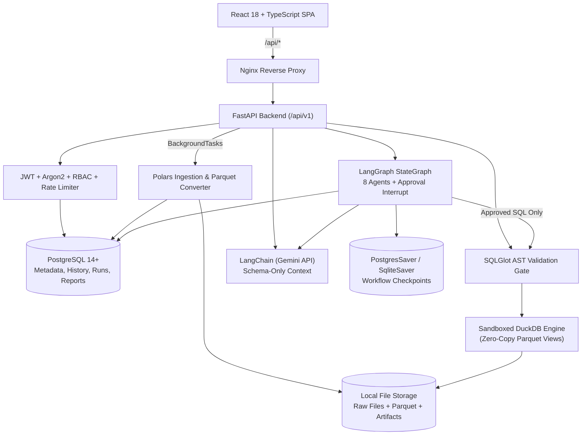

Detailed diagrams covering ingestion pipelines, SQL validation gates, AI Copilot flow, full LangGraph node routing, and all 19 database entities live in [System Architecture & Diagrams](docs/architecture.md).

---

## Installation and Local Development

### Prerequisites
- Python **3.11+** (verified locally with Python **3.13.2**)
- Node.js **20+** / **22+** and npm
- PostgreSQL **14+** (optional locally if using SQLite dev mode; required for production)

### 1. Clone the Repository
```bash
git clone https://github.com/Aakash-Twr/datasense.git
cd datasense
```

### 2. Verify Prerequisites & Generate Demo CSVs (Optional)
```bash
python3 scripts/check_environment.py
python3 scripts/seed_demo_data.py
```

### 3. Backend Setup (`services/api`)
```bash
cd services/api
python3 -m venv .venv
source .venv/bin/activate
pip install -e ".[dev]"

cp .env.example .env
# Edit services/api/.env to configure DATABASE_URL (PostgreSQL or sqlite:///./datasense_dev.db)
# and optionally set GOOGLE_API_KEY for live Gemini Copilot/Agent runs.

alembic upgrade head
uvicorn app.main:app --host 127.0.0.1 --port 8000 --reload
```

### 4. Frontend Setup (`apps/web`)
In a second terminal:
```bash
cd apps/web
npm install
npm run dev
```

Access the application at `http://localhost:5173`. Vite proxies `/api/*` requests directly to `http://127.0.0.1:8000`.

For PostgreSQL installation notes and troubleshooting, see [Installation Guide](docs/getting-started/installation.md) and [Local Development](docs/getting-started/local-development.md).

---

## Docker Deployment

Run the full containerized stack (PostgreSQL 16 + rootless FastAPI API + Nginx 1.27 SPA) locally using Docker Compose:

```bash
cp .env.example .env
docker compose -f deployment/compose/docker-compose.yml up --build -d
./scripts/verify_deployment.sh http://127.0.0.1:8000
```

- **Web UI**: `http://localhost:8080` (Nginx proxies `/api/` to the `api` container with security headers and 30 MB upload allowance).
- **Persistent Volumes**: `datasense_pgdata` (PostgreSQL state) and `datasense_storage` (`/var/lib/datasense/storage`).
- **Migrations & Health**: The backend Dockerfile runs `alembic upgrade head` on startup and exposes `/api/v1/health/live` and `/api/v1/health/ready` container health probes.

For production container manifests (`deployment/compose/docker-compose.prod.yml`), backup scripts, and hardening rules, see [Docker Deployment](docs/deployment/docker-deployment.md) and [Production Configuration](docs/deployment/production-configuration.md).

---

## AI Configuration & Data Privacy

1. **Obtaining a Gemini Key**: Create a key in [Google AI Studio](https://aistudio.google.com/) and set `GOOGLE_API_KEY` inside `services/api/.env` (or container runtime env). Never commit real API keys into `.env.example` or source control.
2. **Model Configuration**: Configure `GEMINI_MODEL` (default `gemini-3.5-flash`), `GEMINI_TEMPERATURE` (`0.1`), and `AI_MAX_REQUESTS_PER_MINUTE` (`5`).
3. **Offline Degraded Mode**: Leaving `GOOGLE_API_KEY` empty runs DataSense cleanly offline without crashes; SQL Studio, ingestion, profiling, and dashboards remain 100% functional while AI endpoints report `{ "configured": false, "available": false }`.
4. **Schema-Only Default Context**: `ContextService` builds Gemini prompts using only dataset/table names, column identifiers, data types, nullability, and sensitive PII labels—**never sending raw dataset rows** by default. Every user must review and accept the AI privacy disclosure (`POST /api/v1/ai/privacy/acknowledge`) before querying AI endpoints. Multi-agent explanation sharing of bounded aggregate summaries is strictly **opt-in** per workflow run.

---

## Security Architecture

- **Password & Session Hygiene**: Argon2id hashing (`pwdlib`), enforced password complexity, 15-minute HS256 JWTs held strictly in browser memory, and HttpOnly refresh cookies rotated on every refresh with automatic session-family revocation on token replay.
- **SQL & DuckDB Defense-in-Depth**: Mandatory `SQLGlot` AST gate (`SELECT`/CTE only, catalog table allowlist, blocked `read_csv`/`read_parquet`/`glob` and system tables) + sandboxed in-memory DuckDB (`enable_external_access = false`, `lock_configuration = true`, query timeout interruption).
- **Human Approval Binding**: Multi-agent SQL execution pauses behind a cryptographic SHA-256 `approval_hash` tying consent to exact SQL statements and active dataset version IDs (`409` invalidation if datasets change mid-review).
- **Storage & HTTP Hardening**: Magic-byte + ZIP-bomb upload checks, symlink-rejecting `LocalStorageService`, CSRF origin verification on cookie endpoints, DB-backed multi-worker rate limiting (`rate_limit_buckets`), secret-redacting log filters, and CSP / `X-Frame-Options: DENY` headers.

See [Security Overview](docs/security/security-overview.md) and [Project Audit](docs/project-audit.md) for full details.

---

## Project Structure

```text
datasense/
├── apps/
│   └── web/                          # React 18 + TypeScript + Vite SPA
│       ├── public/                   # Favicon asset
│       └── src/
│           ├── assets/               # DataSense brand wordmark & mark images
│           ├── components/           # UI primitives, auth, analytics, ai, agents, common
│           ├── layouts/              # Enterprise sidebar & header AppLayout
│           ├── pages/                # Dashboard, Projects, Datasets, SQL, AI Copilot, Multi-Agent, Reports, Admin, Settings
│           ├── services/             # Typed REST API client & token refresh interceptor
│           ├── stores/               # In-memory Zustand authStore
│           ├── styles/               # tokens.css design system & globals.css
│           └── test/                 # Vitest + React Testing Library suites
├── services/
│   └── api/                          # FastAPI backend service
│       ├── alembic/versions/         # Schema migrations (0001 through 0006)
│       ├── app/
│       │   ├── agents/               # LangGraph StateGraph, 8 agents, checkpoints & reports
│       │   ├── ai/                   # LLMFactory, schema context, Copilot & SQL repair services
│       │   ├── analytics/            # DuckDB engine, SQLGlot validator & query telemetry
│       │   ├── api/v1/               # Auth, organizations, projects, datasets, health/metrics routers
│       │   ├── core/                 # Config guards, Argon2/JWT security, rate limiter, logging
│       │   ├── db/                   # SQLAlchemy base & pooled PostgreSQL/SQLite sessions
│       │   ├── ingestion/            # File validator, parsers, profiler, PII scanner, Parquet storage
│       │   ├── models/               # 19 SQLAlchemy 2.x ORM models
│       │   └── schemas/              # Pydantic v2 request/response schemas
│       └── tests/                    # Pytest integration, security, ingestion, SQL & agent tests
├── deployment/
│   ├── compose/                      # docker-compose.yml (local) & docker-compose.prod.yml
│   └── docker/                       # backend.Dockerfile, frontend.Dockerfile, nginx.conf
├── docs/                             # Comprehensive architecture, audit, screenshots, guides & security docs
├── scripts/                          # Environment checks, demo seeding, backup/restore & benchmarking
└── .github/workflows/ci.yml          # CI: Postgres 16 + Ruff + Alembic + Pytest + Vitest + Docker
```

---

## Testing & Verification

### Backend Tests & Linting
```bash
cd services/api
.venv/bin/ruff check app tests
GOOGLE_API_KEY="" .venv/bin/pytest -v
```
Latest observed run: **104 passed, 0 failed** across unit, security, authorization, ingestion, DuckDB/SQLGlot, AI Copilot, and LangGraph multi-agent tests; Ruff lint exited with **0 errors**.

### Frontend Tests, Type-Check, Lint & Build
```bash
cd apps/web
npm test -- --run
npm run type-check
npm run lint
npm run build
```
Latest observed run: **16 test files passed (65 tests total)** via Vitest (`jsdom` + mocked API/auth stores), `tsc --noEmit` **0 errors**, `eslint` **0 errors / 0 warnings**, and clean multi-chunk `vite build`.

### Benchmarking & Deployment Checks
```bash
services/api/.venv/bin/python scripts/benchmark_api.py
./scripts/verify_deployment.sh http://127.0.0.1:8000
```

See [Testing & Benchmarks](docs/development/testing.md) for detailed instructions and M1 benchmark measurements.

---

## Roadmap

### Completed
- Multi-tenant organization workspaces, Argon2 + rotating JWT/cookie auth, and 4-tier RBAC.
- Asynchronous CSV, Excel (multi-sheet), JSON, and Parquet ingestion into Snappy Parquet with profiling and PII alerts.
- Sandboxed DuckDB analytical workspace with SQLGlot AST validation, CodeMirror editor, history, and saved queries.
- Schema-only Google Gemini AI Analytics Copilot with SQL explanation and repair.
- Stateful 8-agent LangGraph analytics orchestration, durable checkpoints, SHA-256 SQL approval gates, deterministic statistics, charts, and 11-section reports.
- Production hardening, Prometheus metrics, observability UI, Docker Compose manifests, and enterprise UI redesign across all application screens.

### Future Possibilities
- Cloud object-storage adapter (S3 / GCS) alongside `LocalStorageService` for horizontal multi-node API scaling.
- External database connectors (direct PostgreSQL/Snowflake/BigQuery federated read sources).
- Email password-reset flows and enterprise OIDC/SAML Single Sign-On integration.
- Collaborative dashboard sharing links and scheduled multi-agent workflow triggers.

---

## Documentation

Browse the complete documentation hub in [`docs/README.md`](docs/README.md), including:
- [Project Audit](docs/project-audit.md)
- [Architecture & Mermaid Diagrams](docs/architecture.md)
- [Screenshots Index](docs/screenshots.md)
- [Installation & Local Setup](docs/getting-started/installation.md)
- [AI Privacy & SQL Security](docs/security/security-overview.md)

---

## Contributing & License

Contributions, bug reports, and documentation improvements are welcome—see [Contributing Guide](docs/development/contributing.md) for local verification and style guidelines.

**License:** No open-source license has yet been selected for this repository. All rights remain reserved by the repository owner until an explicit license file (`LICENSE`) is added.
