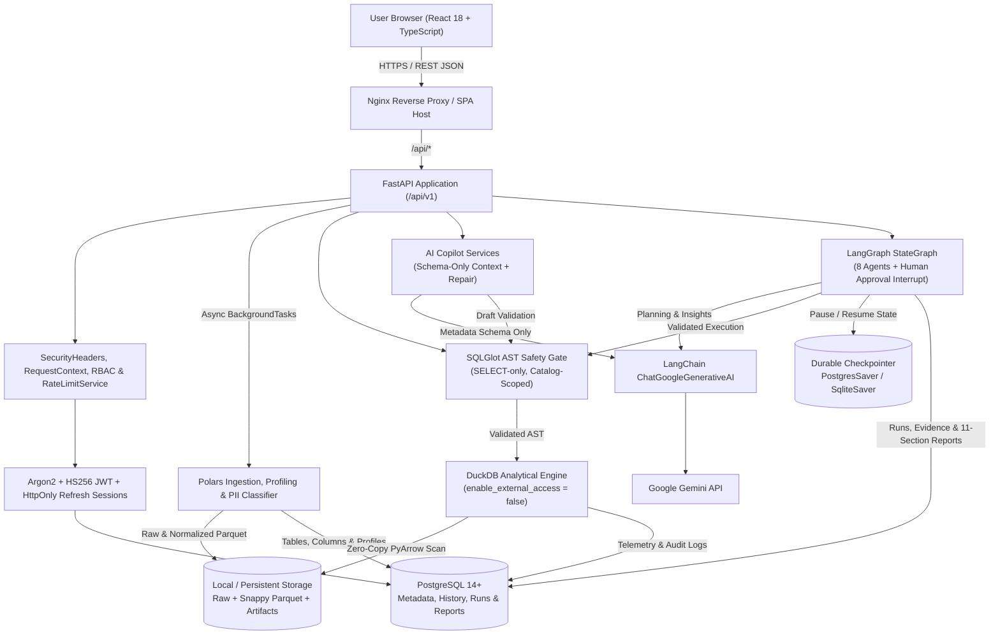
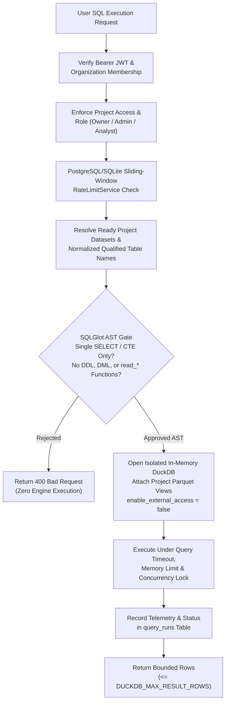
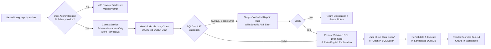
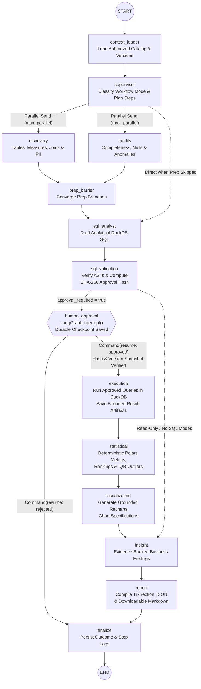
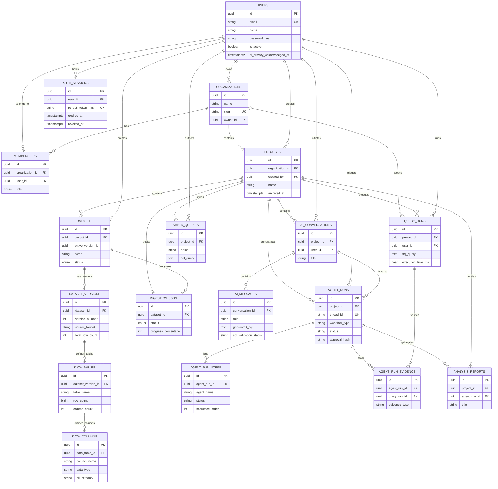

# DataSense System Architecture & Diagrams

This document details DataSense's runtime architecture, asynchronous ingestion pipeline, sandboxed SQL engine, schema-only AI Copilot flow, LangGraph multi-agent orchestration topology, and verified PostgreSQL/SQLAlchemy data model.

---

## A. High-Level System Architecture

DataSense cleanly separates presentation (`apps/web`), API orchestration (`services/api`), persistent relational metadata (`PostgreSQL`), analytical Parquet storage (`LocalStorageService`), zero-copy query execution (`DuckDB` + `SQLGlot`), and stateful LLM workflows (`LangChain` + `LangGraph`).

---

## B. Dataset Ingestion Flow

Uploaded files are authenticated, checked against file size limits (`MAX_UPLOAD_SIZE_BYTES = 25 MB`) and magic byte signatures, written to immutable version directories, and processed asynchronously into normalized Snappy Parquet tables with statistical profiles and PII flags.

```mermaid
flowchart LR
    Upload["File Upload\n(CSV, XLSX, JSON, Parquet)"] --> AuthCheck["Auth, Project Ownership & RBAC\n(Owner / Admin / Analyst)"]
    AuthCheck --> Validate["Validate Extension,\nMagic Bytes & XLSX Zip Safety"]
    Validate --> StoreRaw["Persist Original File &\nRegister Pending Version + Job (202)"]
    StoreRaw --> Parse["Background Worker:\nParse via Polars / fastexcel\n(Multi-Sheet Excel Support)"]
    Parse --> Normalize["Sanitize Identifiers\n(snake_case) & Check Limits"]
    Normalize --> Profile["Compute Stats, Quality Warnings\n& Heuristic PII Tags"]
    Profile --> Parquet["Convert Each Table\nto Snappy Parquet"]
    Parquet --> MetaDB["Register DataTable &\nDataColumn Metadata"]
    MetaDB --> Ready["Dataset Ready\n(Active Version Assigned)"]
```

---

## C. SQL Execution Flow

Every analytical query—whether handwritten in CodeMirror SQL Studio, suggested by AI Copilot, or approved within a Multi-Agent workflow—must pass through strict multi-tenant catalog scoping and AST validation before touching DuckDB.

---

## D. AI Copilot Flow

By default, DataSense **never sends raw customer rows** to external LLM APIs. `ContextService` extracts strictly bounded metadata (dataset names, table names, column types, nullability, and sensitive PII tags) for Gemini SQL drafting, followed by deterministic SQLGlot verification and one optional AST repair attempt.

---

## E. Multi-Agent LangGraph Workflow

Compiled in `services/api/app/agents/graph.py`, the LangGraph `StateGraph` orchestrates specialized nodes, fan-out `Send` branches for independent metadata discovery and quality auditing, a mandatory SHA-256 bound human approval `interrupt()`, durable checkpoint persistence, deterministic Polars statistical analysis, Recharts specification generation, and 11-section executive reporting.

---

## F. Database Entity Relationship Diagram

All core PostgreSQL tables use UUID v4 primary keys and timezone-aware UTC timestamps (`TimestampMixin`). Foreign-key relationships below match the verified SQLAlchemy ORM models under `services/api/app/models/`.

> **Note**: Standalone rate-limiting state is persisted in `rate_limit_buckets` (`key PK`, `window_start`, `count`, `expires_at`), and LangGraph checkpoint serialization stores graph resume state inside `PostgresSaver` / `SqliteSaver` tables keyed by opaque `thread_id`.

For table-by-table column specifications, see [Database Schema Reference](architecture/database-schema.md).
